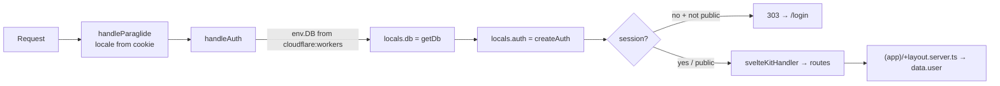

# Repository Guidelines

## Project Overview

**Maido Book** (package `maido-book`; the worker is still `crm-app` and the D1 database `crm-db`) is an early-stage CRM. It is a SvelteKit 3 / Svelte 5 app deployed to **Cloudflare Workers** with a **D1** (SQLite) database. It has Google sign-in (better-auth) and two locales, Indonesian (default) and English, through Paraglide. It is a CS follow-up CRM for a consumable product: daily follow-up queue (`/`), customers, orders (each order schedules the next reorder follow-up), insights, settings (products, rules, WhatsApp templates) and Excel import (`/import`). Sign-in is limited to the `ALLOWED_EMAILS` allowlist.

## Architecture & Data Flow



- **Single hook pipeline:** `src/hooks.server.ts` runs `sequence(handleParaglide, handleAuth)`.
- **Per-request services:** the hook creates the DB and auth instances on every request and stores them on `locals`. Use `locals.db` and `locals.auth` in server code. Do not create module-level singletons, because the D1 binding is only available per request.
- **Auth gating is centralized in the hook.** Only `/api/auth/*` and route id `/login` are public. Everything else redirects to `/login` when there is no session. `(app)/+layout.server.ts` relies on this and uses `locals.user!`. If you add a public route, update `isPublic` in the hook.
- **Bindings:** read them with `import { env } from 'cloudflare:workers'`, not `event.platform`. Secrets come from `$app/env/private` and are declared in `src/env.ts` with `defineEnvVars`. When you add a new env var, declare it there and in `.env.example`.
- **Auth:** `src/lib/server/auth.ts` defines `createAuth(db)`, which wires better-auth with the drizzle sqlite adapter and Google. The `sveltekitCookies` plugin must stay **last**. `export const auth = createAuth(null!)` exists only for the `auth` CLI.
- **Mutations:** use form actions (`+page.server.ts`) with `fail()`/`redirect()` from `@sveltejs/kit`. Logout is `POST /logout` (`src/routes/logout/+server.ts`). There is no `handleError`; `src/routes/+error.svelte` and `src/routes/(app)/+error.svelte` render `ErrorState`.

## CRM Domain

- Core rule: `followUpDue = orderDate + max(0, ceil(qty × servingsPerUnit / dosePerDay) − leadDays)` (`src/lib/domain/follow-up.ts`). Pure client-safe domain code lives in `src/lib/domain/` (unit-tested); DB access in `src/lib/server/crm/`.
- One open follow-up per customer (partial unique index). Dates are `YYYY-MM-DD` in Asia/Jakarta (`todayIso()`).
- `resolve()` takes route ids including the group: `resolve('/(app)/customers')`.
- Add env var `ALLOWED_EMAILS` (comma-separated); production: `wrangler secret put ALLOWED_EMAILS`.

## Key Directories

| Path                                      | Purpose                                                                                                                 |
| ----------------------------------------- | ----------------------------------------------------------------------------------------------------------------------- |
| `src/routes/(app)/`                       | Authenticated area (layout with header, language switcher, avatar menu)                                                 |
| `src/routes/login/`, `src/routes/logout/` | Public sign-in (form action `?/google`), sign-out endpoint                                                              |
| `src/lib/server/`                         | Server-only: `auth.ts`, `db/index.ts` (`getDb`, `Db` type), `db/schema.ts`                                              |
| `src/lib/server/db/auth.schema.ts`        | **Generated** by `pnpm auth:schema`. Do not hand-edit                                                                   |
| `src/lib/components/ui/`                  | shadcn-svelte components (generated, excluded from ESLint)                                                              |
| `src/lib/components/`                     | App components (e.g. `page-header.svelte`)                                                                              |
| `src/routes/**/<name>.svelte`             | Route-only sections, colocated with their page and typed from `./$types`. Shared components go in `src/lib/components/` |
| `src/lib/paraglide/`                      | **Generated** i18n runtime (gitignored)                                                                                 |
| `messages/{id,en}.json`                   | Translation source of truth                                                                                             |
| `drizzle/`                                | SQL migrations, applied by wrangler D1 (`migrations_dir`)                                                               |

## Development Commands

```sh
pnpm install            # runs prepare: paraglide compile + svelte-kit sync + husky
pnpm dev                # vite dev (http://localhost:5173)
pnpm check              # wrangler types + svelte-check (main type gate)
pnpm lint               # prettier --check . && eslint .
pnpm format             # prettier --write .
pnpm test               # vitest --run   (pnpm test:unit = watch)
pnpm build              # wrangler types && vite build
pnpm preview            # wrangler dev on built worker, port 4173
pnpm deploy             # build + wrangler deploy

pnpm gen                # regenerate worker-configuration.d.ts after editing wrangler.jsonc
pnpm db:generate        # drizzle-kit generate → drizzle/NNNN_*.sql
pnpm db:migrate:local   # apply to local D1 (crm-db)
pnpm db:migrate:remote  # apply to remote D1
pnpm auth:schema        # regenerate src/lib/server/db/auth.schema.ts from auth config
pnpm paraglide          # recompile messages (the vite plugin also does this on dev/build)
```

**Schema change workflow:** edit tables in `src/lib/server/db/schema.ts` or a new file it re-exports, then run `pnpm db:generate`, commit `drizzle/NNNN_*.sql` together with `drizzle/meta/`, then run `pnpm db:migrate:local`. Never edit an applied migration. Migrations own the schema: better-auth runs with `validateSchema: false`, and there is no `drizzle-kit push` script.

## Code Conventions & Common Patterns

- **Formatting:** Prettier uses tabs, single quotes, no trailing commas, and `printWidth` 100, with the svelte and tailwind plugins. `/drizzle/`, `/static/`, and `worker-configuration.d.ts` are prettier-ignored.
- **Imports:** use the `#lib` alias (package.json `imports`): `#lib/...`, not `$lib`. The existing suffix pattern is `.js` for components and paraglide (`#lib/utils.js`, `#lib/paraglide/messages.js`) and `.ts` for server modules (`#lib/server/auth.ts`). SvelteKit's `$lib/server` import guard does **not** cover `#lib/server`, so never import `#lib/server/*` from client code.
- **Svelte 5 runes only.** Runes mode is forced in `vite.config.ts`. Use `$props()`, `$derived`, and `$bindable`. Read page state from `$app/state`, not `$app/stores`. Build links with `resolve()` from `$app/paths`. Type props with `./$types` (`PageProps`, `LayoutProps`, `PageServerLoad`, `Actions`, `RequestHandler`).
- **Naming:** components use kebab-case filenames. shadcn parts are named `<component>-<part>.svelte` and re-exported via `index.ts`; import them as `import * as Card from '#lib/components/ui/card/index.js'`. Add new shadcn components with `pnpm dlx shadcn-svelte@latest add <name>` (aliases are in `components.json`).
- **Styling:** Tailwind v4 lives in `src/routes/layout.css` (oklch theme vars, `.dark`). Merge classes with `cn()` from `#lib/utils.js` and define variants with `tailwind-variants`.
- **i18n:** never hardcode UI strings. Add every key to **both** `messages/id.json` and `messages/en.json`. Keys are flat snake_case with a screen prefix (`login_title`, `dashboard_welcome`); shared keys have no prefix (`sign_out`). Placeholders look like `{name}`. Usage: `m.dashboard_welcome({ name })`. The base locale is `id` and the locale is stored in a cookie.
- **Errors:** form actions return `fail(status, { flag })` and the page reads it as `form?.flag`. Redirects use `redirect(303, ...)`. Missing bindings throw explicitly (see the `env.DB` check in the hook).
- **Commits:** Conventional Commits (`feat: ...`). Work happens on `development`, with `main` as the base branch. The pre-commit hook runs `lint-staged`, which applies prettier and `eslint --fix` to staged files.

## Important Files

- `src/hooks.server.ts`: request pipeline, auth gate, locals setup
- `src/app.d.ts`: `App.Locals` (`user?`, `session?`, `db`, `auth`)
- `src/env.ts`: env var declarations (`ORIGIN`, `BETTER_AUTH_SECRET`, `GOOGLE_CLIENT_ID`, `GOOGLE_CLIENT_SECRET`)
- `vite.config.ts`: SvelteKit plugin and adapter (there is **no** `svelte.config.js`), Paraglide plugin, Vitest config
- `wrangler.jsonc`: worker `crm-app`, D1 binding `DB` → `crm-db`, `nodejs_als` flag
- `drizzle.config.ts`: sqlite dialect, schema `src/lib/server/db/schema.ts`, out `drizzle/`
- `project.inlang/settings.json`: locales `["id","en"]`, base `id`
- `worker-configuration.d.ts`: generated by `pnpm gen` (also run by `prepare`, `check` and `build`). Gitignored; do not edit

## Runtime/Tooling Preferences

- **pnpm only** (`pnpm-lock.yaml`, `engineStrict: true`, `allowBuilds` for `workerd`/`esbuild`). The README's `npm run` commands are leftover template text.
- The target runtime is the Cloudflare Workers runtime (workerd), not Node. Do not rely on Node-only APIs beyond what `nodejs_als` provides. `worker-configuration.d.ts` is gitignored and regenerated by `pnpm check`/`pnpm build`, because wrangler only adds the `mainModule` type when `.svelte-kit/cloudflare/_worker.js` exists, so a committed copy goes stale whenever a build is present or missing.
- For local dev, copy `.env.example` to `.env`. The Google OAuth redirect URI is `<ORIGIN>/api/auth/callback/google`. Paraglide compilation loads inlang plugins from a CDN, so it needs network access.

## Testing & QA

- Vitest 4 is configured with one `server` project (node environment) that includes `src/**/*.{test,spec}.{js,ts}`. `*.svelte.test.ts` files are excluded, and no browser or component test setup exists (no jsdom or Playwright).
- Put tests next to the source they cover, e.g. `src/lib/server/foo.test.ts`. Import `describe`, `it`, and `expect` from `vitest`; globals are off. `expect.requireAssertions` is on, so a test with no assertions fails.
- Run a single file with `pnpm vitest --run src/lib/server/foo.test.ts`.
- There is no coverage config and no CI. Before finishing a change, run `pnpm check`, `pnpm lint`, and `pnpm test`.
