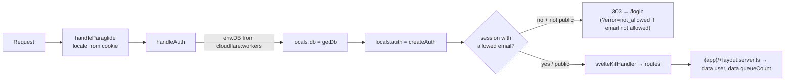

# Repository Guidelines

## Project Overview

**Maido Book** (package `maido-book`; the Worker is `maido-book` and the D1 database `maido-book-db`) is an early-stage CRM. It is a SvelteKit 3 / Svelte 5 app deployed to **Cloudflare Workers** with a **D1** (SQLite) database. It has Google sign-in (better-auth) and two locales, Indonesian (default) and English, through Paraglide. It is a CS follow-up CRM for a consumable product: daily follow-up queue (`/`), customers, orders (each order schedules the next reorder follow-up), insights, settings (products, rules, WhatsApp templates), Excel import (`/import`) and `/more` (the phone's "Lainnya" page: remaining nav items and preferences). WhatsApp messages are sent through `wa.me` links (`waLink()` in `src/lib/domain/phone.ts`); there is no WhatsApp API integration. Sign-in is limited to the `ALLOWED_EMAILS` allowlist.

## Architecture & Data Flow



- **Single hook pipeline:** `src/hooks.server.ts` runs `sequence(handleParaglide, handleAuth)`.
- **Per-request services:** the hook creates the DB and auth instances on every request and stores them on `locals`. Use `locals.db` and `locals.auth` in server code. Do not create module-level singletons, because the D1 binding is only available per request.
- **Auth gating is centralized in the hook.** Only `/api/auth/*` and route id `/login` are public. Everything else redirects to `/login` when there is no session. A session only counts if its email passes `isAllowedEmail()` (`src/lib/server/allowed-emails.ts`); a valid Google session whose email is not allowed is sent to `/login?error=not_allowed`. `(app)/+layout.server.ts` relies on this and uses `locals.user!`. If you add a public route, update `isPublic` in the hook.
- **Bindings:** read them with `import { env } from 'cloudflare:workers'`, not `event.platform`. Secrets come from `$app/env/private` and are declared in `src/env.ts` with `defineEnvVars`. When you add a new env var, declare it there and in `.env.example`.
- **Auth:** `src/lib/server/auth.ts` defines `createAuth(db)`, which wires better-auth (`better-auth/minimal`) with the drizzle sqlite adapter and Google. A `user.create.before` database hook rejects emails outside the allowlist. `validateSchema: false` skips per-request schema introspection. `session.cookieCache` (5 minutes) serves the session from a signed `session_data` cookie instead of D1; the hook still checks the allowlist on every request. The `sveltekitCookies` plugin must stay **last**. `export const auth = createAuth(null!)` exists only for the `auth` CLI.
- **Mutations:** use form actions (`+page.server.ts`) with `fail()`/`redirect()` from `@sveltejs/kit`. Logout is `POST /logout` (`src/routes/logout/+server.ts`). There is no `handleError`; `src/routes/+error.svelte` and `src/routes/(app)/+error.svelte` render `ErrorState`. The catch-all `(app)/[...rest]` throws 404 so unknown URLs render inside the app shell.
- **Atomic writes:** D1 has no interactive transactions. Multi-statement writes go through `runBatch()` (`src/lib/server/crm/batch.ts`, a D1 batch).
- **Batched reads:** each D1 query is a network round trip, so a page load sends all its reads in one `locals.db.batch([...])`. Reads are split into a query builder (`queueQuery`, `rulesQuery`, `customerDetailQueries`, ...) and a pure mapper (`toQueue`, `toRules`, `toCustomerDetail`, ...). Batch results are row arrays, so use `rows[0]` where you would use `.get()`. **Wrap the fields of every joined select that goes into a batch in `batchSafe()`**: D1 batch rows are keyed by column name, so same-named columns (`customer.id`, `follow_up.id`) collide and the values shift into the wrong fields. In a single-table select, drizzle writes a column in a raw `sql` field as a bare `"id"`, so name the table in correlated subqueries (`${customer}.${sql.identifier('id')}`).
- **Server-Timing:** every response reports `auth-init`, `session` (D1 trips), `db` (trip count and summed wait) and `total` (`src/lib/server/db/timing.ts`). Check the trip count in DevTools after you change a load.

## CRM Domain

- Core rule: `followUpDue = orderDate + max(0, ceil(qty × servingsPerUnit / dosePerDay) − leadDays)` (`daysOfSupply` and `reorderDueDate` in `src/lib/domain/follow-up.ts`). Pure client-safe domain code lives in `src/lib/domain/` (unit-tested); DB access in `src/lib/server/crm/`.
- After a manual outcome, `planAfterOutcome()` decides the next follow-up: `retry`/`closing` after `retryDays`, up to `maxAttempts`, then the customer goes `dormant` with a `winback` after `winbackDays`. `planImportedCustomer()` maps the Excel "last action" column the same way.
- One open follow-up per customer (partial unique index `follow_up_one_open_idx` on `customer_id` where `status = 'open'`). Dates are `YYYY-MM-DD` strings in Asia/Jakarta (`todayIso()`, `src/lib/domain/dates.ts`); timestamps are epoch ms.
- Rules live in the single `setting` row (`id = 1`). WhatsApp templates are one `message_template` row per follow-up kind, with placeholders `{nama}`, `{cs}`, `{produk}` (`src/lib/domain/template.ts`). Default product, rules and templates are inserted by migrations `0002`/`0003`.
- Insights (`src/lib/server/crm/insights.ts`): an order counts toward conversion only if its customer got a `wa_sent` activity in the 14 days up to its order date.
- `resolve()` takes route ids including the group: `resolve('/(app)/customers')`.
- Add env var `ALLOWED_EMAILS` (comma-separated, case-insensitive); production: `wrangler secret put ALLOWED_EMAILS`.

## Key Directories

| Path                                      | Purpose                                                                                                                                                    |
| ----------------------------------------- | ---------------------------------------------------------------------------------------------------------------------------------------------------------- |
| `src/routes/(app)/`                       | Authenticated area (layout with `side-nav` on desktop, `bottom-nav` on phone; language and theme in the user menu and `/more`)                             |
| `src/routes/login/`, `src/routes/logout/` | Public sign-in (form action `?/google`), sign-out endpoint                                                                                                 |
| `src/lib/server/`                         | Server-only: `auth.ts`, `allowed-emails.ts`, `db/index.ts` (`getDb`, `Db` type), `db/schema.ts` (re-exports `auth.schema.ts` and `crm.schema.ts`)          |
| `src/lib/server/crm/`                     | CRM queries and mutations, valibot form schemas (`schemas.ts`, `form.ts`), shared follow-up actions (`follow-up-actions.ts`)                               |
| `src/lib/server/db/auth.schema.ts`        | **Generated** by `pnpm auth:schema`. Do not hand-edit                                                                                                      |
| `src/lib/domain/`                         | Pure, client-safe domain logic and enums (`types.ts`), with colocated tests                                                                                |
| `src/lib/components/ui/`                  | shadcn-svelte components (generated, excluded from ESLint)                                                                                                 |
| `src/lib/components/`                     | App components (e.g. `page-header.svelte`); `app-shell/` holds the nav, user menu and `nav-items.ts`                                                       |
| `src/routes/**/<name>.svelte`             | Route-only sections, colocated with their page and typed from `./$types`. Shared components go in `src/lib/components/`                                    |
| `src/lib/paraglide/`                      | **Generated** i18n runtime (gitignored)                                                                                                                    |
| `messages/{id,en}.json`                   | Translation source of truth                                                                                                                                |
| `drizzle/`                                | SQL migrations, applied by wrangler D1 (`migrations_dir`)                                                                                                  |
| `static/templates/`                       | Import template `.xlsx` linked from `/import`, built by `pnpm template:build`; `import-template.test.ts` checks it against the parser                      |
| `scripts/seed/local.sql`                  | Local demo data (`pnpm db:seed:local`). Idempotent, only touches ids starting with `seed_`, dates relative to today. Never run against the remote database |
| `.agents/skills/`, `.claude/skills/`      | Vendored agent skills and their Claude Code symlinks (see Agent Skills)                                                                                    |
| `DESIGN.md`, `PRODUCT.md`                 | Design system (colors, type, components) and product context. Read before UI work                                                                          |
| `docs/`                                   | Local working docs (plans, gap lists). Gitignored; never commit them                                                                                       |

## Development Commands

```sh
pnpm install            # runs prepare: paraglide compile + wrangler types + svelte-kit sync + husky
pnpm dev                # vite dev (http://localhost:5173)
pnpm check              # wrangler types + svelte-kit sync + svelte-check (main type gate)
pnpm lint               # prettier --check . && eslint .
pnpm format             # prettier --write .
pnpm test               # vitest --run   (pnpm test:unit = watch)
pnpm build              # wrangler types && vite build
pnpm preview            # wrangler dev on built worker, port 4173
pnpm deploy             # build + wrangler deploy

pnpm gen                # regenerate worker-configuration.d.ts after editing wrangler.jsonc
pnpm db:generate        # drizzle-kit generate → drizzle/NNNN_*.sql
pnpm db:migrate:local   # apply to local D1 (maido-book-db)
pnpm db:migrate:remote  # apply to remote D1
pnpm db:seed:local      # load scripts/seed/local.sql into local D1
pnpm auth:schema        # regenerate src/lib/server/db/auth.schema.ts from auth config
pnpm template:build     # rebuild the import template (after changing import headers, LAST_ACTIONS or limits)
pnpm paraglide          # recompile messages (the vite plugin also does this on dev/build)
```

**Schema change workflow:** edit tables in `src/lib/server/db/schema.ts` or a new file it re-exports, then run `pnpm db:generate`, commit `drizzle/NNNN_*.sql` together with `drizzle/meta/`, then run `pnpm db:migrate:local`. Never edit an applied migration. Migrations own the schema: better-auth runs with `validateSchema: false`, and there is no `drizzle-kit push` script.

## Code Conventions & Common Patterns

- **Formatting:** Prettier uses tabs, single quotes, no trailing commas, and `printWidth` 100, with the svelte and tailwind plugins. `.prettierignore` skips lockfiles, `/drizzle/`, `/static/`, `worker-configuration.d.ts`, `project.inlang/*` (except `settings.json`), `/.agents/` and `skills-lock.json`. ESLint ignores everything in `.gitignore` plus `worker-configuration.d.ts`, `src/lib/components/ui/**` and `.agents/**`.
- **Imports:** use the `#lib` alias (package.json `imports`): `#lib/...`, not `$lib`. Suffixes follow the existing code: `.svelte` for components, `.js` for paraglide, `#lib/utils.js` and component-folder modules (shadcn `index.js`, `app-shell/nav-items.js`), and `.ts` for other TS modules (`#lib/server/auth.ts`, `#lib/domain/dates.ts`, `#lib/format.ts`). SvelteKit's `$lib/server` import guard does **not** cover `#lib/server`, so never import `#lib/server/*` from client code.
- **Svelte 5 runes only.** Runes mode is forced in `vite.config.ts`. Use `$props()`, `$derived`, and `$bindable`. Read page state from `$app/state`, not `$app/stores`. Build links with `resolve()` from `$app/paths`. Type props with `./$types` (`PageProps`, `LayoutProps`, `PageServerLoad`, `Actions`, `RequestHandler`).
- **Naming:** components use kebab-case filenames. shadcn parts are named `<component>-<part>.svelte` and re-exported via `index.ts`; import them as `import * as Card from '#lib/components/ui/card/index.js'`. Add new shadcn components with `pnpm dlx shadcn-svelte@latest add <name>` (aliases are in `components.json`).
- **Styling:** Tailwind v4 lives in `src/routes/layout.css` (oklch theme vars, `.dark` via `mode-watcher`, custom `desk` variant for wide non-touch screens). Merge classes with `cn()` from `#lib/utils.js` and define variants with `tailwind-variants`. Visual rules are in `DESIGN.md`.
- **i18n:** never hardcode UI strings. Add every key to **both** `messages/id.json` and `messages/en.json`. Keys are flat snake_case with a screen prefix (`login_title`, `customer_delete_title`); shared keys have no prefix (`sign_out`). Placeholders look like `{name}`. Usage: `m.customer_delete_title({ name })`. The base locale is `id` and the locale is stored in a cookie.
- **Forms and errors:** actions parse `FormData` with a valibot schema from `src/lib/server/crm/schemas.ts` through `parseForm()` and return `fail(400, { errors, values })` (plus `action` when a page has several forms). `errors` maps field → code (`required`, `invalid`, `too_long`, `out_of_range`, `duplicate`); render it with `fieldError()` from `#lib/labels.ts`. Simple failures use a flag (`fail(400, { invalid: true })`, read as `form?.invalid`). Success redirects use `redirect(303, ...)`, with `?toast=<key>` to show a toast (keys in `flash-toast.svelte`). Missing bindings throw explicitly (see the `env.DB` check in the hook).
- **Commits and branches:** use Conventional Commits with a scope where it fits (`feat(orders): ...`). `main` is the only long-lived branch and should stay deployable. Start each change from an up-to-date `main` on a short-lived `feat/...`, `fix/...`, or `chore/...` branch; open a pull request, run project checks and review, merge, then delete the branch. Do not keep a permanent `development` branch. Protect `main` on the remote against force-push and deletion; require checks and review where available. The husky pre-commit hook runs `lint-staged`: prettier and `eslint --fix` on staged `*.{js,ts,svelte}`, prettier on `*.{json,jsonc,css,md,html,yaml,yml}`.

## Agent Skills

- Skills are vendored in `.agents/skills/` (managed by `npx skills`, pinned by commit and hash in `skills-lock.json`) and symlinked into `.claude/skills/`. Both are committed. Do not edit vendored skill files; update them with the skills CLI. They are excluded from Prettier and ESLint.
- `svelte-code-writer`: load before creating, editing or analyzing any `.svelte`, `.svelte.ts` or `.svelte.js` file (Svelte docs lookup and autofixer).
- `svelte-core-bestpractices`: load when writing or reviewing Svelte components or modules (reactivity, events, styling).
- `shadcn-svelte`: load when adding, updating, styling or composing components in `src/lib/components/ui/` or using the shadcn-svelte CLI.
- `.claude/` is shared and committed, except `.claude/settings.local.json` and `.claude/worktrees/`, which are gitignored and stay local, as are other agents' folders (`.omp/`, `.pi/`).

## Important Files

- `src/hooks.server.ts`: request pipeline, auth gate and allowlist check, locals setup
- `src/app.d.ts`: `App.Locals` (`user?`, `session?`, `db`, `auth`) and `App.PageState` (`item?`, the follow-up open in the phone's shallow-routed queue detail)
- `src/env.ts`: env var declarations (`ORIGIN`, `BETTER_AUTH_SECRET`, `GOOGLE_CLIENT_ID`, `GOOGLE_CLIENT_SECRET`, `ALLOWED_EMAILS`)
- `vite.config.ts`: SvelteKit plugin and adapter (there is **no** `svelte.config.js`), Paraglide plugin, Vitest config
- `wrangler.jsonc`: worker `maido-book`, D1 binding `DB` → `maido-book-db`, `nodejs_als` flag
- `drizzle.config.ts`: sqlite dialect, schema `src/lib/server/db/schema.ts`, out `drizzle/`
- `src/lib/server/db/crm.schema.ts`: CRM tables (`product`, `customer`, `customer_order`, `follow_up`, `activity`, `setting`, `message_template`)
- `project.inlang/settings.json`: locales `["id","en"]`, base `id`
- `worker-configuration.d.ts`: generated by `pnpm gen` (also run by `prepare`, `check` and `build`). Gitignored; do not edit

## Runtime/Tooling Preferences

- **pnpm only** (`pnpm-lock.yaml`, `engineStrict: true`, `allowBuilds` for `workerd`/`esbuild`).
- The target runtime is the Cloudflare Workers runtime (workerd), not Node. Do not rely on Node-only APIs beyond what `nodejs_als` provides. `worker-configuration.d.ts` is gitignored and regenerated by `pnpm check`/`pnpm build`, because wrangler only adds the `mainModule` type when `.svelte-kit/cloudflare/_worker.js` exists, so a committed copy goes stale whenever a build is present or missing.
- For local dev, copy `.env.example` to `.env`. The Google OAuth redirect URI is `<ORIGIN>/api/auth/callback/google`. Paraglide compilation loads inlang plugins from a CDN, so it needs network access.

## Testing & QA

- Vitest 4 is configured with one `server` project (node environment) that includes `src/**/*.{test,spec}.{js,ts}`. `*.svelte.{test,spec}.{js,ts}` files are excluded, and no browser or component test setup exists (no jsdom or Playwright).
- Put tests next to the source they cover, e.g. `src/lib/domain/follow-up.test.ts`. Import `describe`, `it`, and `expect` from `vitest`; globals are off. `expect.requireAssertions` is on, so a test with no assertions fails.
- Run a single file with `pnpm vitest --run src/lib/domain/follow-up.test.ts`.
- There is no coverage config and no CI. Before finishing a change, run `pnpm check`, `pnpm lint`, and `pnpm test`.
